<div align="center">

# hello-microduck

**手把手做一只 MicroDuck**
从买零件、打印外壳、焊接接线，到写系统、标定，一步一步来，每一步都有照片。

[**打开在线教程 →**](https://hello-microduck.pages.dev) ·
[飞特 HD-1910 方案](https://hello-microduck.pages.dev/feetech/) ·
[在线调试工具](https://hello-microduck.pages.dev/tool/)

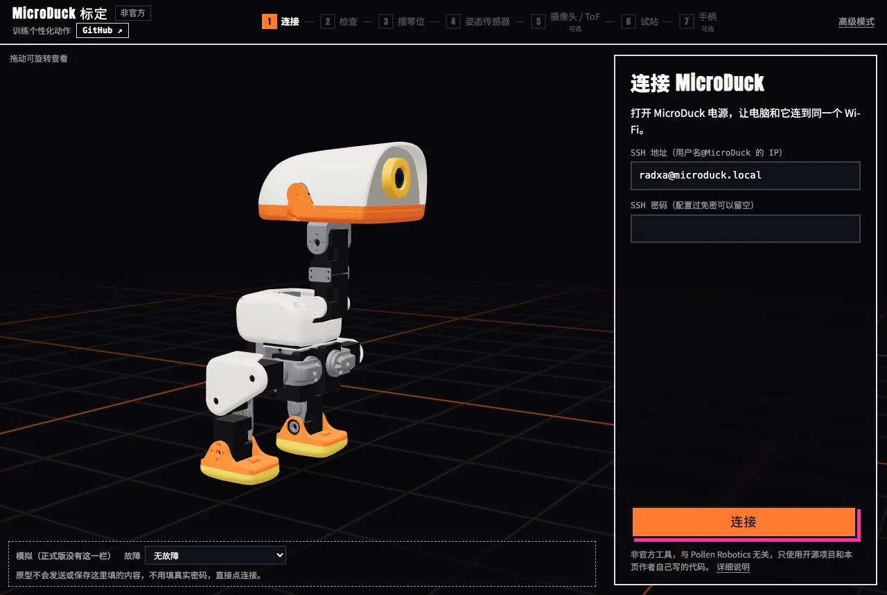

</div>

> **非官方教程。**与 MicroDuck 官方团队 Pollen Robotics 无关，没有得到官方授权或认可。MicroDuck 是 Pollen Robotics 的[开源项目](https://github.com/pollen-robotics/microduck)，这里只写作者自己的装机经验和调试工具。

## 目录

- [选一个方案](#选一个方案)
- [飞特方案一共五步](#飞特方案一共五步)
  - [第 1 步：准备材料和打印](#第-1-步准备材料和打印)
  - [第 2 步：给舵机设-id](#第-2-步给舵机设-id)
  - [第 3 步：主板、HAT 和接线](#第-3-步主板hat-和接线)
  - [第 4 步：写入系统、通电](#第-4-步写入系统通电)
  - [第 5 步：用调试工具标定](#第-5-步用调试工具标定)
  - [调试工具功能说明](#调试工具功能说明)
- [采购清单和价格](#采购清单和价格)
- [还在补充](#还在补充)
- [修改这个教程](#修改这个教程)
- [第三方资料和署名](#第三方资料和署名)

## 选一个方案

| 方案 | 状态 | 说明 |
|---|---|---|
| [飞特 HD-1910](https://hello-microduck.pages.dev/feetech/) | 可以开始 | 用飞特 HD-1910 舵机代替官方 XL330，舵机便宜好买，装配多几步 |
| [官方 XL330](https://hello-microduck.pages.dev/xl330/) | 准备中 | 官方原版做法，装起来更简单 |

## 飞特方案一共五步

五步在同一个长页面里连续阅读，目录和“继续”按钮直接定位，不用重新加载页面。

| 步骤 | 做什么 | 要用到 |
|---|---|---|
| 1 | [准备材料和打印](#第-1-步准备材料和打印) | 采购清单、3D 打印机 |
| 2 | [给舵机设 ID](#第-2-步给舵机设-id) | TTL 调试板、Windows 电脑 |
| 3 | [主板、HAT 和接线](#第-3-步主板hat-和接线) | 电烙铁、焊锡、万用表 |
| 4 | [写入系统、通电](#第-4-步写入系统通电) | TF 卡读卡器、USB-C 数据线 |
| 5 | [用调试工具标定](#第-5-步用调试工具标定) | 一台和 MicroDuck 同一 Wi-Fi 的电脑 |

> **先读这一条：**飞特方案换了舵机，要先确认 HAT 的版本。原版 HAT 和飞特舵机的线序不同；推荐的飞特兼容版可以直接接飞特舵机线。不确定的地方，先停下来对照板上标注和接线图。

---

### 第 1 步：准备材料和打印

先把零件买齐，再打印外壳，零件到手前就可以先开始打印。采购清单见下面的[采购清单和价格](#采购清单和价格)。

| 耗材和零件 | 说明 |
|---|---|
| 外壳和结构件 | 3D 打印，要打印适配 HD-1910 的版本（飞特和官方 XL330 的外形尺寸不一样） |
| 软质零件 | 名字里带“软质”的（比如嘴部软垫）用 TPU，其余用普通硬质耗材 |
| 颜色 | 随你喜欢，不影响功能 |

<table>
<tr>
<td width="50%" align="center"><br><sub><b>舵机互连线</b>：作者用的永成电子 AMP2.0，100 mm 特软硅胶 24#，双头反向</sub></td>
<td width="50%" align="center">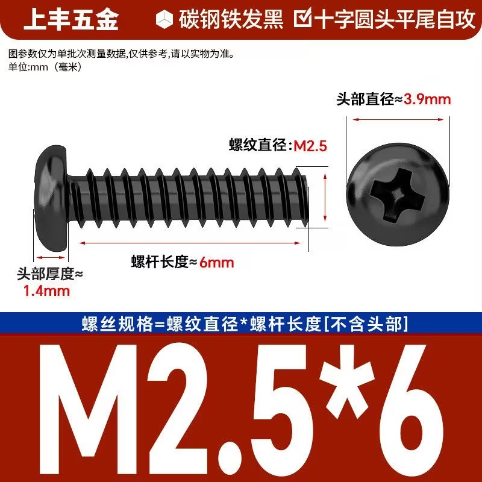<br><sub><b>连接螺丝</b>：碳钢发黑 M2.5×6 十字圆头平尾自攻，1 包 100 个足够</sub></td>
</tr>
</table>

> **线材不稳，也可能让鸭子走路卡顿、摔倒。**舵机随附线材可能出现丢包，所以建议另购连接可靠的互连线。出现卡顿时，也要同时排查供电、接触和总线状态。

> **打印文件还在整理，补上后会更新这里。**

### 第 2 步：给舵机设 ID

15 颗舵机接在同一根线上，主板靠编号（ID）区分它们。新舵机出厂是同一个编号，所以**装之前要一颗一颗改好**。

**怎么设**

1. **一次只接一颗舵机**，两颗同时接编号一样，软件分不清。
2. 调试板接电脑 USB，舵机用反向调试线接到调试板上。
3. 打开飞特调试软件，波特率选 1 Mbps，搜索舵机。新舵机出厂编号是 1。
4. 把编号改成下表的数字，写入保存。
5. 让舵机转到 `2048`（正中间），第 3 步装舵盘时要它在中间。
6. 马上在舵机上贴纸写编号，拔下来，换下一颗。

**每颗舵机的编号**（按后视方向排布：MicroDuck 背对你；文中的“左／右”都是它自己的左右）

|  | 左腿 | 头部 | 右腿 |
|---|:---:|:---:|:---:|
| 髋转向 | **20** | 脖子前后 **30** | **10** |
| 髋侧摆 | **21** | 头部点头 **31** | **11** |
| 髋前后 | **22** | 头部左右转 **32** | **12** |
| 膝 | **23** | 头部侧歪 **33** | **13** |
| 踝 | **24** | 嘴 **34** | **14** |

这套编号和官方 MicroDuck 一致，后面的系统和调试工具都按它来认舵机。

**HD-1910-C001 的几个数字**（来自飞特规格书）

| 项目 | 数值 |
|---|---|
| 编号范围 | 0–253，出厂是 1 |
| 通信速度 | 38400 bps – 1 Mbps，出厂是 1 Mbps |
| 转动范围 | 360°，读数 0–4095 |
| 中位 | 2048 |
| 每一格 | 约 0.088° |

### 第 3 步：主板、HAT 和接线

这一步接摄像头、焊 ToF、看清舵机线序，最后把舵机装进身体。

#### 3.1 摄像头接到主板

轻轻掀起主板排线座上的卡扣，把排线插到底，再把卡扣压回去，轻拉一下排线不松就对了。

<div align="center">
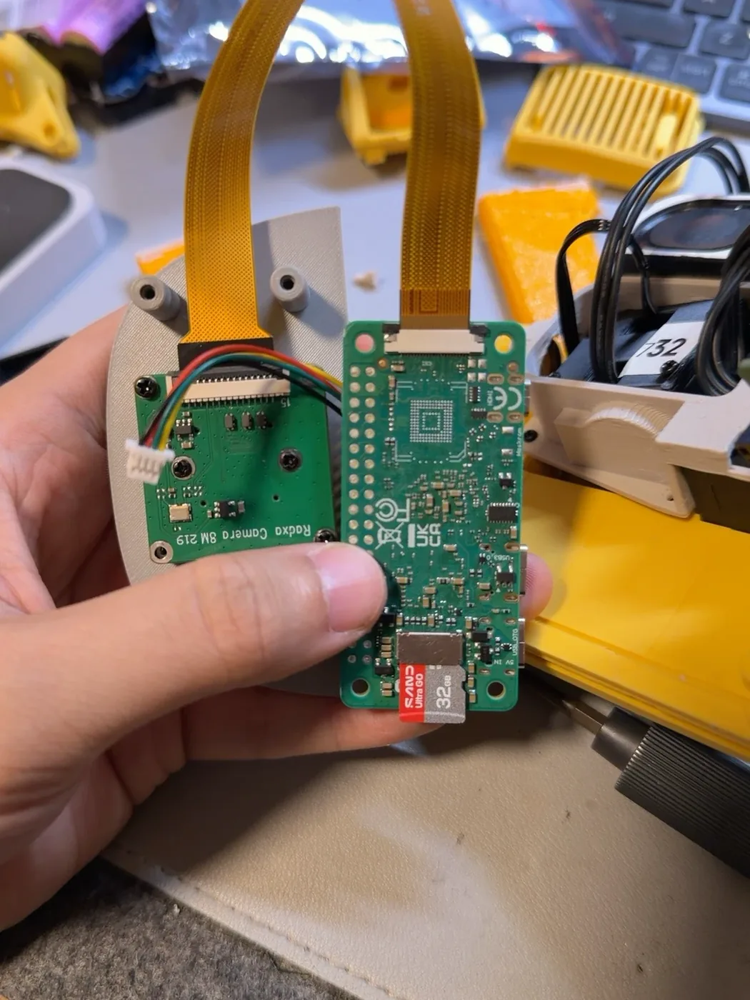<br>
<sub><b>图 1</b>：摄像头（左）用排线接到 ZERO 3W 主板（右）</sub>
</div>

#### 3.2 焊 ToF

ToF（VL53L5X）是测距的“眼睛”，装在头上。用 SH1.0 4P 转杜邦线：杜邦那头焊到 ToF 模块上，SH1.0 那头插到 HAT 板上。

<table>
<tr>
<td width="50%" align="center">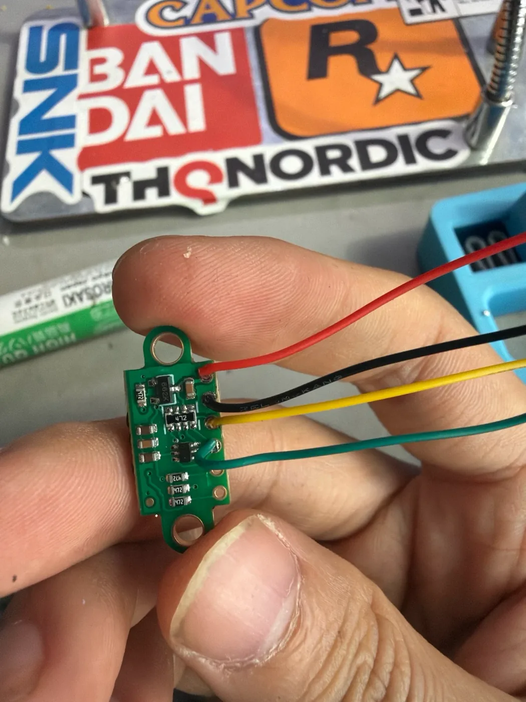<br><sub><b>图 2</b>：背面，四根线焊在上面四个孔</sub></td>
<td width="50%" align="center">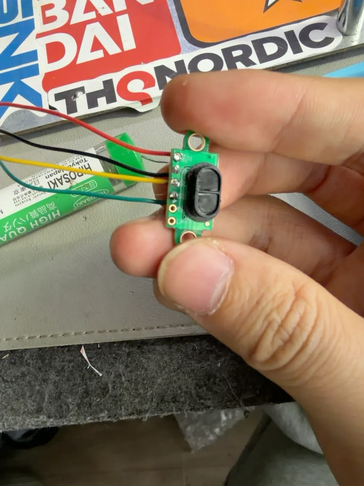<br><sub><b>图 3</b>：正面，中间黑色的是传感器窗口，别弄脏</sub></td>
</tr>
</table>

六个小孔从上到下这样接：

| 线色 | ToF 孔位 | 接到 HAT 的 J5 |
|---|---|---|
| 🔴 红 | VIN | 2 号脚（3.3V） |
| ⚫ 黑 | GND | 1 号脚（GND） |
| 🟡 黄 | SCL | 4 号脚（SCL） |
| 🟢 绿 | SDA | 3 号脚（SDA） |
| 不接 | INT | — |
| 不接 | LPn | — |

<div align="center">
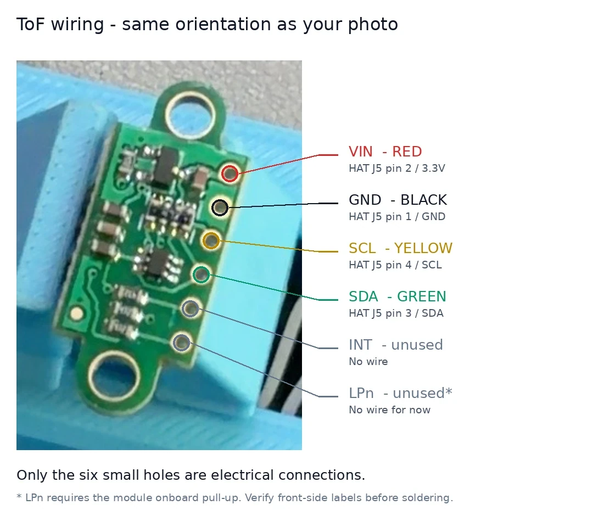<br>
<sub><b>图 4</b>：ToF 六个孔的定义。只有六个小孔是电气连接，两个大孔是安装孔</sub>
</div>

> 不同批次的模块孔位顺序可能不同，焊之前按正面印的字核对一遍。LPn 不接线时，靠模块板上自带的上拉电阻。

#### 3.3 ToF 插到 HAT 的 J5

SH1.0 那头插到 **J5**，1 号脚在靠近 J6 的一侧。

<div align="center">
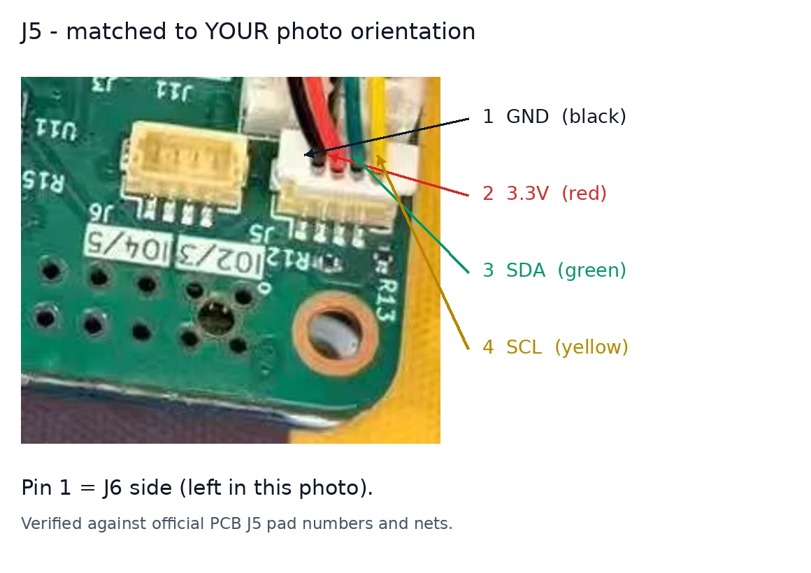<br>
<sub><b>图 5</b>：HAT 板上的 J5，1 号脚在 J6 一侧（图中左边）</sub>
</div>

#### 3.4 看清舵机线序

舵机和原版 HAT 的 1、3 号脚定义是反的，所以原版 HAT 要用反向线（1 ↔ 3，2 ↔ 2）。**推荐的飞特兼容 HAT 按自己的兼容接口接，不要再照原版表额外反接。**

<table>
<tr>
<td width="50%" align="center">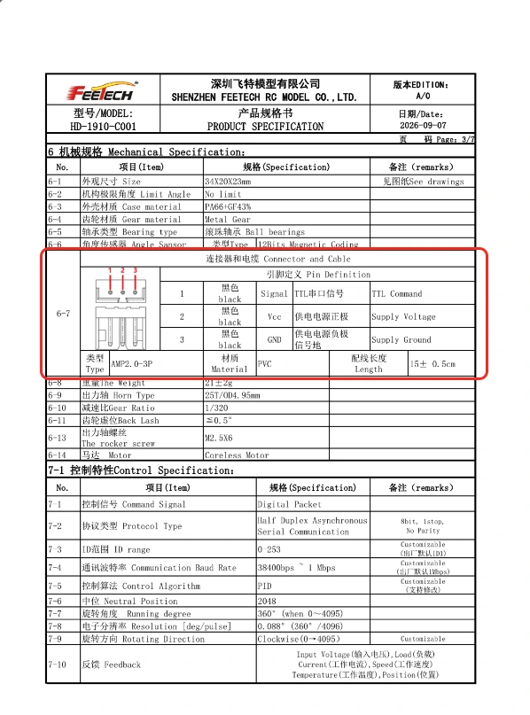<br><sub><b>图 6</b>：舵机线序（飞特 HD-1910-C001 规格书）</sub></td>
<td width="50%" align="center">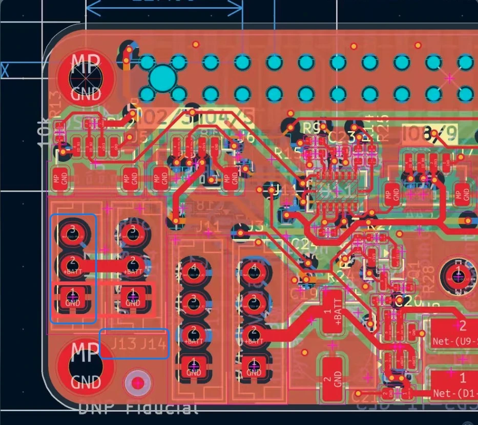<br><sub><b>图 7</b>：原版 HAT 的线序，框出的是 J13、J14</sub></td>
</tr>
</table>

| 脚位 | 舵机（AMP2.0-3P） | 原版 HAT（J13 / J14） |
|:---:|---|---|
| 1 | 信号 | GND |
| 2 | 电源正（Vcc） | 电源正（+BATT） |
| 3 | GND | 信号 |

> **上电前一定要确认：**断电，用万用表核对线两端的信号、电源和 GND。线材商品名里的“同向／反向”不能代替实际针脚核对；信号和 GND 接错，舵机不会回应。

#### 3.5 按单 J13 方案接总线

这套接法只用 HAT 的 J13，J14 留空。头颈舵机、两条腿和 IMU 接到同一条三线总线上。

<div align="center">
<a href="site/assets/img/single-j13-wiring.png">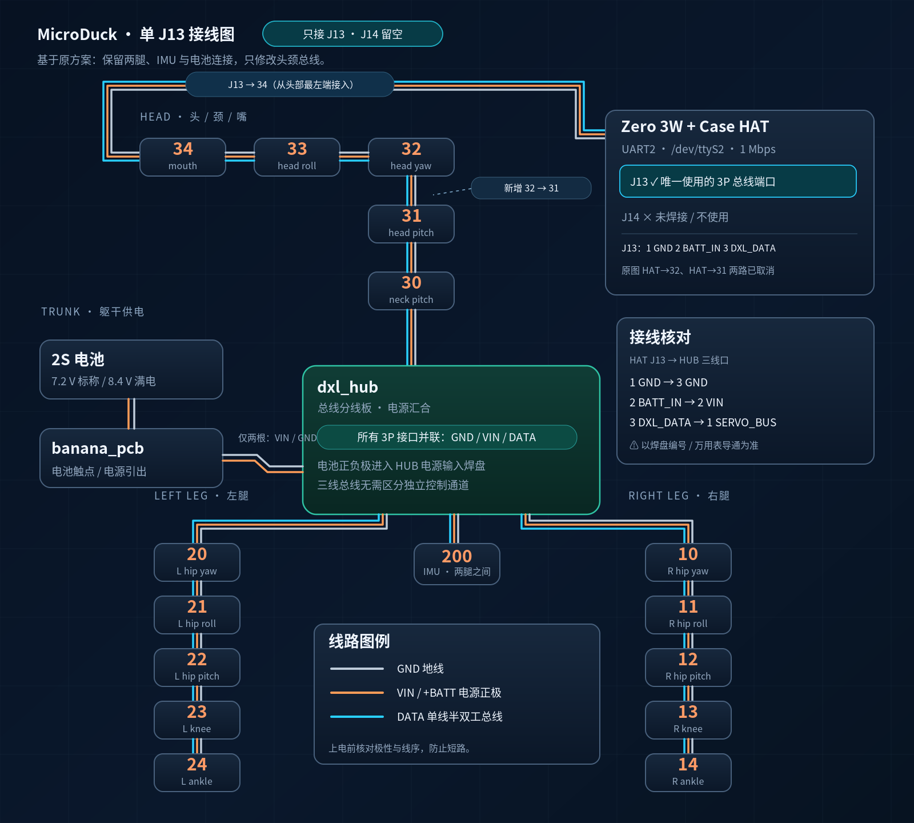</a><br>
<sub><b>接线总图</b>：按后视方向排布，左腿 20–24 在图左，右腿 10–14 在图右。HAT 针脚为原版参考，点击可看原图</sub>
</div>

- **头颈：**`J13 → 34 → 33 → 32 → 31 → 30 → dxl_hub`
- **两腿和 IMU：**HUB 分别接左腿 `20 → 21 → 22 → 23 → 24`、右腿 `10 → 11 → 12 → 13 → 14` 和 `IMU 200`
- **电池：**2S 电池经 `banana_pcb` 引出 VIN 和 GND 两根线，接到 HUB 的电源输入焊盘

#### 3.6 装舵机

1. 按第 2 步的编号表，把每颗舵机装到对应的关节，贴纸上的编号要和位置对上。
2. 装舵盘之前，确认舵机还在 `2048` 中位，装的时候别转动舵机轴。
3. 舵机线按上面的总图接，走线别被关节夹住。

装偏了也能救：第 5 步的调试工具会提示你，并告诉你怎么拆下来转回 2048。

### 第 4 步：写入系统、通电

把系统写进 TF 卡，插到主板上，再从正确的 C 口接电。

1. **写入系统：**TF 卡插到读卡器，用 Armbian Imager 选系统镜像，选对盘符，写完并校验通过再拔卡。*（适配这套硬件的镜像还在整理，见[还在补充](#还在补充)。）*
2. **插 TF 卡：**卡槽在主板背面，**金属触点朝向电路板，印字的一面朝外**，推到底（见上面的图 1，右侧主板下端露出的红灰色卡就是 TF 卡）。
3. **接电：**主板上有两个 USB-C 口，**靠近 TF 卡、印着 `USB_OTG` 和 `5V IN` 的那个**才是供电和调试接口，印着 `USB3` 的不用来供电。线要能传数据，只能充电的线连不上电脑。
4. **第一次开机**比较慢，等一两分钟。
5. 如果要用无线手柄，让 MicroDuck 连 **5 GHz** Wi-Fi，2.4 GHz 可能和手柄互相干扰（经验来自 [kissqy 的飞特版常见问题](https://github.com/kissqy/Microduck-kissqy/blob/main/docs/MICRODUCK-FAQ.md)）。

### 第 5 步：用调试工具标定

系统写好、通上电以后，用[调试工具](https://hello-microduck.pages.dev/tool/)一步一步标定。每个舵机装得都有一点不一样，标定就是告诉 MicroDuck 它的“正中间”在哪。

<table>
<tr>
<td width="50%" align="center">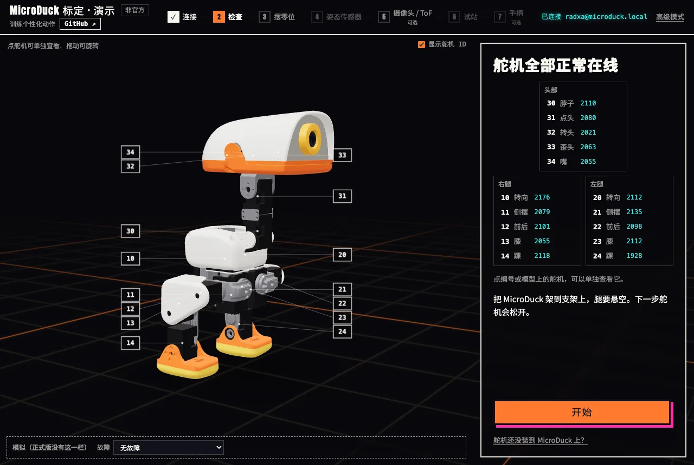<br><sub><b>检查</b>：15 颗舵机全部正常在线，有问题会直接告诉你 ID</sub></td>
<td width="50%" align="center">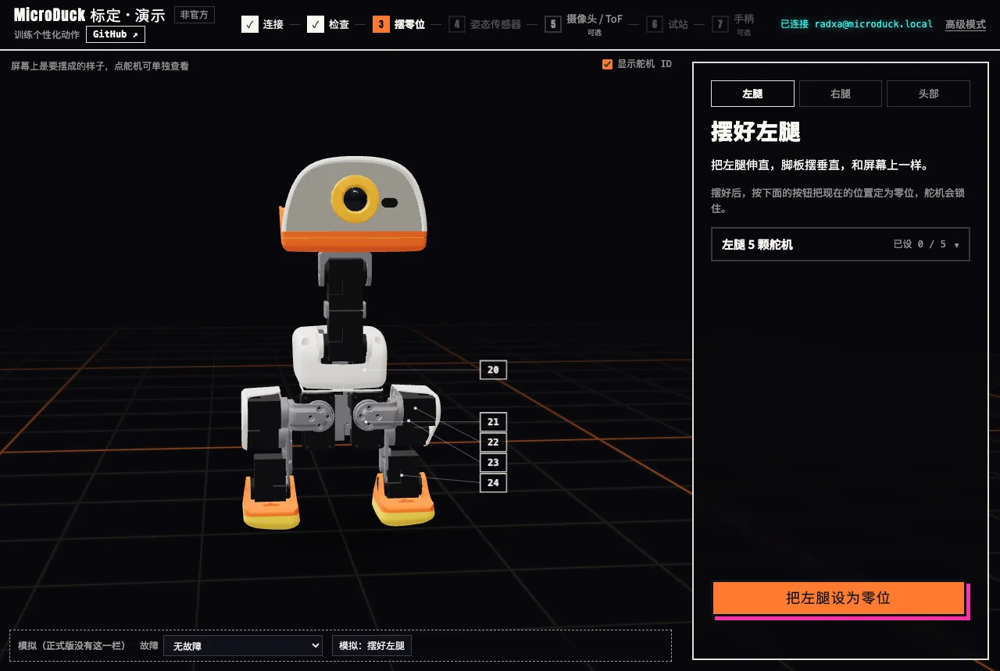<br><sub><b>摆零位</b>：照屏幕把腿和头摆正，一次设一条腿，也可以一颗一颗设</sub></td>
</tr>
</table>

工具里一共七步：

| # | 步骤 | 做什么 |
|:---:|---|---|
| 1 | 连接 | 填 MicroDuck 的地址，连上主控 |
| 2 | 检查 | 15 颗舵机全部正常在线，哪颗有问题直接说出 ID |
| 3 | 摆零位 | 摆正腿和头，设为零位；超出范围会提示拆下来转回 2048 |
| 4 | 姿态传感器 | 扶正、前倾、左倾，各停一下 |
| 5 | 摄像头 / ToF（可选） | 确认画面和距离变化，可单独跳过 |
| 6 | 试站 | 让它慢慢站起来；局部有偏差可以只重标一颗，或按 0.1° / 0.5° 微调 |
| 7 | 手柄（可选） | 连上手柄，学几个常用按键 |

> **现在是演示版：**调试工具用模拟数据，可以先熟悉流程，还不会连接或控制真实的 MicroDuck。标定和修正只在本次页面会话中保留，刷新后重置。

标定完想让 MicroDuck 学会自己的动作，可以用作者的训练实验室：[heranhe/microduck-lab-cloud](https://github.com/heranhe/microduck-lab-cloud)。

### 调试工具功能说明

下面是工具里每一步的界面和用法。截图来自演示版（模拟数据）。顶部的步骤条可以点：点到还没解锁的步骤，会弹出对话框告诉你前面缺什么，并带你去补。

#### 1–3　连接、检查、摆零位

- **连接：**填 MicroDuck 的 SSH 地址（默认 `radxa@microduck.local`），免密配置过的话密码可以留空。
- **检查：**读 15 颗舵机的编号和当前位置。全部在线显示“舵机全部正常在线”，有异常会直接点名是哪个 ID。点模型上的舵机或编号，可以单独高亮查看，其余变成半透明。
- **摆零位：**按屏幕上的样子把左腿、右腿、头摆正，再点“设为零位”。可以整个部位一起设，也可以展开后一颗一颗设。如果某颗舵机在装配时被转过头、超出这个关节的范围，会提示你拆下来转回 `2048` 再装回去。

#### 4　姿态传感器

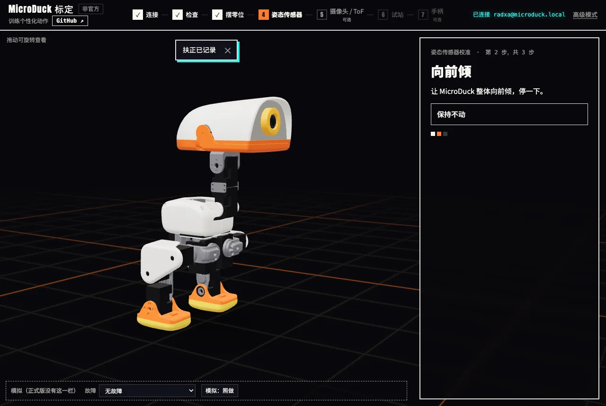

分三步：扶正、向前倾、向左倾，每一步按提示摆好姿势并停一下，工具记录一次读数。要在零位设好之后才能做。

#### 5　摄像头与 ToF（可选）

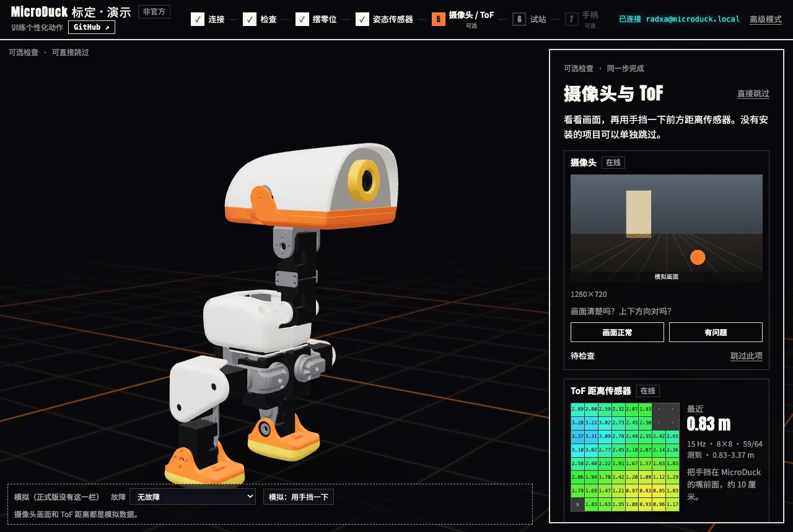

- **摄像头：**看画面是否清楚、上下方向对不对，点“画面正常”或“有问题”。
- **ToF：**右侧是 8×8 的深度矩阵，颜色从暖到冷表示从近到远，`x` 表示没测出来。先确认前方无遮挡，再把手挡在嘴前面约 10 厘米，距离变近就说明接对了。
- 两项分别记录，可以只通过一个、跳过另一个，也可以点“跳过未检查项，继续”。这一步不是试站的前提，跳过之后可以在完成页补做。

#### 6　试站

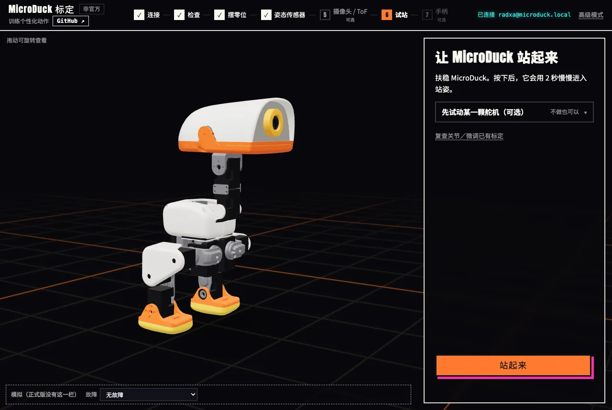

- 扶稳 MicroDuck 后点“站起来”，它会用 2 秒慢慢进入站姿。想先确认某颗舵机方向对不对，可以展开“先试动某一颗舵机”，这一项可选。
- 站姿和屏幕上的模型对不上时，选“有偏差”，再选关节或部位：
  - **小偏差：**单关节微调，步长 0.1° 或 0.5°，每颗最多调 ±3°。先“试用”，效果合适再“保存”，保存后重新试站。
  - **零位摆错或拆装过：**重标这一颗，或整个部位重新摆零位。只替换选中的关节，其余 14 颗的结果保留。
- “复查关节／微调已有标定”可以不走流程，直接回到关节查看。

#### 7　手柄（可选）

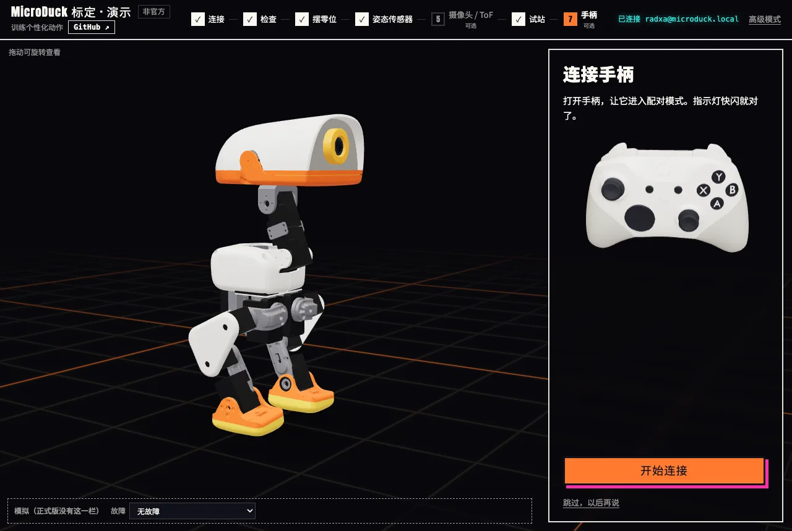

让手柄进入配对模式，点“开始连接”，指示灯快闪就对了；连上以后学几个常用按键。不用手柄可以点“跳过，以后再说”。

> 标定、微调和检查结果都只在当前页面会话里保留，刷新后重置；刷新时如果有没保存的微调，会先提示。完整的交互规则在 [docs/calibration-interaction.md](docs/calibration-interaction.md)。

---

## 采购清单和价格

按核心硬件、传感器、电路板、机械结构和调试工具分成五类。**价格是作者的采购记录，下单时以店铺为准。**

### 一、核心硬件

| 配件 | 已购数量 | 实际需求 | 单价 | 金额 |
|---|---:|---:|---:|---:|
| 飞特 HD-1910-C001 舵机 | 17 颗 | 15 颗 | ¥83.00 | ¥1,411.00 |
| Radxa ZERO 3W 2GB 主控 | 1 块 | 1 块 | ¥309.00 | ¥309.00 |
| MicroDuck Robot HAT（推荐飞特兼容版） | 1 块 | 1 块 | ¥120.00 | ¥120.00 |
| 32GB TF 卡 | 1 张 | 1 张 | ¥73.00 | ¥73.00 |
| **小计** | | | | **¥1,913.00** |

舵机多买了 2 颗备用。按装机所需的 15 颗算，**核心硬件单机成本 ¥1,747.00**。

### 二、传感器及音频

| 配件 | 数量 | 金额 |
|---|---:|---:|
| VL53L5X V2 ToF 测距模块 | 1 块 | ¥49.50 |
| 3525 腔体扬声器（4Ω 3W） | 1 个 | ¥3.08 |
| 摄像头模块（Radxa Camera 8M 219，带排线） | 1 个 | 待核实 |
| IMU 模块 | 1 个 | 计入下面的 PCB 套件 |
| **已知小计** | | **¥52.58** |

### 三、电路板及连接线

| 配件 | 数量 | 金额 |
|---|---:|---:|
| IMU + HUB + 电池接线 PCB 套件（含 IMU、dxl_hub、banana_pcb） | 1 套 | ¥89.00 |
| 5264-3P 转 AMP2.0 反向调试线（设 ID 用） | 1 根 | ≈ ¥3.00 |
| SH1.0 4P 转杜邦母头线 20 cm（接 ToF 用） | 5 根 | ¥4.80 |
| AMP2.0-3P 舵机互连线（建议另购） | 16 根 | ¥33.80（含运费 ¥8） |
| **参考小计** | | **≈ ¥130.60** |

### 四、机械结构及紧固件

| 配件 | 数量 | 金额 |
|---|---:|---:|
| 6700 轴承 | 3 个 | |
| ET2216 轴承 | 11 个 | |
| 轴承合计 | 14 个 | ¥41.00 |
| M2.5×6 十字圆头平尾自攻螺丝 | 1 包（100 个） | 待补充 |
| 3D 打印结构件 | 1 套 | 未统计 |
| **已知小计** | | **¥41.00** |

轴承数量是采购记录，装机数量还需按适配 HD-1910 的 CAD BOM 核对。

### 五、必要调试工具

| 工具 | 数量 | 用途 | 金额 |
|---|---:|---|---:|
| 灵影 TTL Adapter(A) 调试板 | 1 块 | 舵机 ID 编号、参数配置、调试 | ¥31.00 |

### 汇总

| 类别 | 金额 |
|---|---:|
| 一、核心硬件（含 2 颗备用舵机） | ¥1,913.00 |
| 二、传感器及音频 | ¥52.58 |
| 三、电路板及连接线 | ≈ ¥130.60 |
| 四、机械结构及紧固件 | ¥41.00 |
| 五、必要调试工具 | ¥31.00 |
| **已列项目参考合计** | **≈ ¥2,168.18** |

> 这**不是完整的装机总价**：还没有计入摄像头、螺丝、打印耗材、电池等待核实或没列价格的项目。另外要自备：电池、打印耗材、TF 读卡器、电烙铁和焊锡、一台电脑。

### 推荐板卡

作者推荐从同一家店买 **HAT、IMU 转接板和香蕉电源板（banana_pcb）**，商品标题为“microduck开源机器鸭 kissqy开源仓库同款HAT加IMU TO DXL套件”，选**飞特兼容版本**：可直接兼容飞特舵机线，R33 电阻已优化，喇叭可直插。 [淘宝链接 ↗](https://e.tb.cn/h.jRVOJbCVQ9ESt2i?tk=dURX6YsSy3l)

## 还在补充

- [ ] HD-1910 版打印文件的下载地址和打印参数
- [ ] 适配这套硬件的系统镜像和下载地址
- [ ] 摄像头价格、轴承装机数量（按 CAD BOM 核对）
- [ ] 调试工具接实机的版本
- [ ] 官方 XL330 方案的教程

## 修改这个教程

页面正文在 `src/pages/` 里，改完运行：

```bash
python3 build.py
```

在本机预览，然后打开 <http://localhost:8000>：

```bash
python3 -m http.server 8000 --directory site
```

```text
hello-microduck/
├── build.py              生成网站：给正文套上页头、步骤导航和页脚
├── src/
│   ├── style.css         网站样式
│   └── pages/            每一页的正文
├── tool/
│   └── calibration.html  调试工具（单文件）
├── docs/                 设计说明和 README 配图
└── site/                 生成好的网站，直接部署这个目录
    └── assets/img/       教程照片（已去掉位置等元数据）
```

部署到 Cloudflare Pages：输出目录填 `site`，不需要构建命令。本地部署会先重新生成网站，再上传到 <https://hello-microduck.pages.dev>：

```bash
npm ci
npm run deploy
```

需要 Wrangler 已登录且有 Cloudflare Pages 写权限。此项目使用直接上传，推送 GitHub 不会自动触发部署。

## 第三方资料和署名

- 调试工具里的 MicroDuck 3D 模型、关节范围、配色和地面网格算法来自 [pollen-robotics/microduck-simulator](https://huggingface.co/spaces/pollen-robotics/microduck-simulator) 和 [pollen-robotics/microduck](https://github.com/pollen-robotics/microduck)，Apache-2.0。
- 调试工具里的手柄 3D 模型基于 “[Xbox Elite Controller](https://sketchfab.com/3d-models/xbox-elite-controller-32aad0ff25f7446b8afe649ea3cc9e43)”，作者 [Rusfort](https://sketchfab.com/Rusfort)，[CC-BY-4.0](http://creativecommons.org/licenses/by/4.0/)。已删除背部拨片和按键外层透明罩，去掉贴图和按键上的 logo。
- 3D 渲染库 three.js（MIT）；字体 Anton 和 Noto Sans SC（SIL OFL）。
- 图 6 截自飞特 HD-1910-C001 产品规格书，图 7 截自 Robot HAT 的 PCB 工程。
- “用 5 GHz Wi-Fi 避免和手柄干扰”的经验来自 [kissqy/Microduck-kissqy](https://github.com/kissqy/Microduck-kissqy)。
- 文中出现的 MicroDuck、Xbox、飞特、GameSir 等名称归各自所有者，只用来说明兼容关系。

## 许可

还没有选定许可证，选好后补上。
